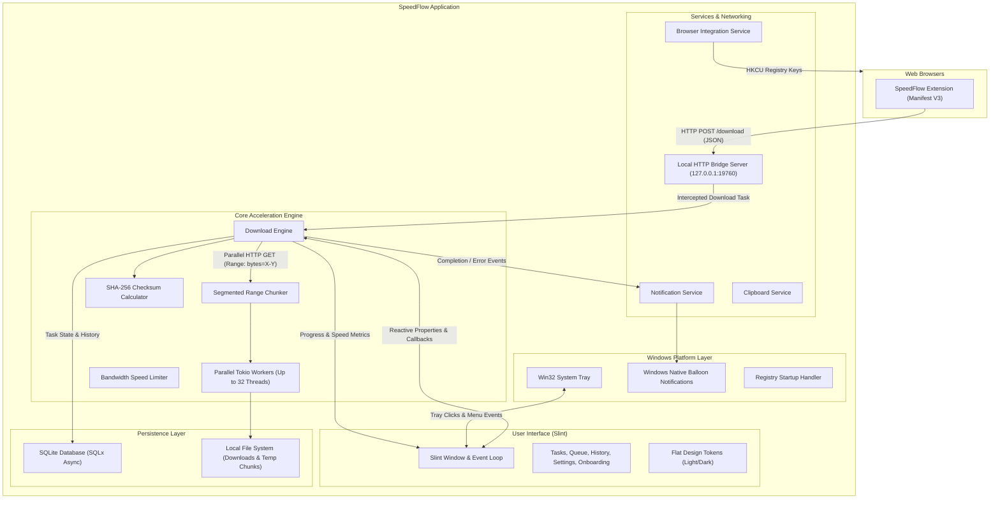

# SpeedFlow Architecture Documentation

This document describes the architectural design, core subsystems, data flow, and design patterns utilized in SpeedFlow.

---

## 1. Architectural Overview and Design Principles

SpeedFlow is a desktop download manager and accelerator engineered in Rust (2024 edition) with a Slint declarative user interface. It is architected around the following core principles:

- **Maximum Throughput:** Files are divided into multiple byte-range segments and downloaded concurrently over parallel HTTP connections to saturate available bandwidth.
- **Minimal Resource Footprint:** Unlike Electron-based alternatives that consume hundreds of megabytes of RAM, SpeedFlow compiles to a compact native binary (~13 MB) that operates efficiently with minimal CPU and memory overhead.
- **Privacy First (Zero Telemetry):** SpeedFlow operates completely locally. All network communication is strictly between your machine and your target download servers, with an internal localhost bridge for browser communication. No telemetry or analytics are collected.
- **Monolithic Flat UI:** Built on a desktop-first design language with high information density, clear visual hierarchies, and first-class support for both Light and Dark modes.
- **Windows-First Native Integration:** Uses native Win32 APIs for system tray interactions, registry integration, and shell notifications, structured on a modular codebase capable of future cross-platform expansion.

---

## 2. High-Level System Architecture

The following diagram illustrates the interaction between SpeedFlow subsystems:

---

## 3. Subsystem Breakdown

### 3.1 Core Multi-Threaded Engine (`src/core/`, `src/engine/`)

The core engine is responsible for downloading files with maximum throughput, resilience, and data integrity:

- **HTTP 206 Partial Content Detection:** Before initiating chunked downloads, the engine performs an HTTP `HEAD` request to inspect response headers (`Accept-Ranges`, `Content-Length`). If range requests are supported, multi-threaded acceleration is activated; otherwise, it falls back gracefully to single-stream download.
- **Segmented Range Chunker:** Divides total file size into equal byte slices according to user configuration (e.g. 8, 16, or 32 connections). Each chunk is requested concurrently via Tokio worker tasks using `Range: bytes=start-end` HTTP headers.
- **Dynamic Speed Limiting:** When the user enables the download speed limiter, transfer rates across all active connections are throttled using token-bucket rate limiting to conserve network bandwidth for other applications.
- **Fault-Tolerant Auto-Resume:** If internet connection drops temporarily, worker tasks retry failed chunks automatically with progressive backoff (up to 5 retries per chunk).
- **Integrity Verification:** Once all segments finish downloading, they are merged sequentially into the target destination file, and a SHA-256 checksum is computed automatically.

### 3.2 User Interface Layer (`src/ui/`)

SpeedFlow's graphical interface is built using Slint (v1.18.1):

- **Declarative Slint Components:** UI definitions are written in Slint markup and compiled into native Rust code during build time via `slint-build`.
- **Flat Monolithic Design System:** Adheres to a desktop-first design language using monolithic panes and hairline borders rather than fluffy cards. Color palettes and spacing tokens are centralized in `colors.slint` and `tokens.slint`.
- **Theme Modes:** Dynamically toggles between Dark Theme and Light Theme at runtime without requiring an application restart.
- **Onboarding Wizard:** Dedicated 4-step first-run wizard (`onboarding_view.slint`) that introduces new users to visual styling, download folder selection, connection concurrency, and browser extension setup.

### 3.3 Storage and Persistence (`src/storage/`)

All application state is preserved locally using an embedded SQLite database managed via SQLx:

- **Asynchronous SQLx:** Database operations are completely non-blocking, ensuring the user interface remains responsive at 60 FPS even during heavy disk read/write activity.
- **Task Queue Scheduling:** Tracks tasks through state transitions (`downloading`, `paused`, `queued`, `completed`, `failed`). When the maximum number of simultaneous active downloads is reached, new downloads automatically wait in queue until active slots open.
- **Historical Records:** Completed downloads are archived in the `history` table along with file size, completion timestamp, destination path, and computed SHA-256 checksums.

### 3.4 Browser Integration (`src/services/browser_integration.rs`, `src/services/bridge_server.rs`)

Browser integration enables automatic download interception without manual copying and pasting:

- **Localhost Bridge Server:** A lightweight HTTP server built on Tokio listening on `127.0.0.1:19760`. It accepts download payloads containing URL, filename, cookies, and referrer information.
- **Cross-Browser WebExtension:** Built as a Manifest V3 extension compatible with Google Chrome, Microsoft Edge, Brave, and Mozilla Firefox.
- **Windows Registry Auto-Registration:** For Microsoft Edge and Mozilla Firefox, SpeedFlow writes integration entries to the Windows Current User registry (`HKCU\Software\Microsoft\Edge\Extensions` and `HKCU\Software\Mozilla\Firefox\Extensions`), enabling immediate connection.
- **Embedded Asset Fallback:** To ensure portability, all extension assets (manifest, background script, popup, and icons) are embedded directly into the binary using `include_bytes!`. If the extension directory is ever missing from disk, SpeedFlow extracts it automatically into the local AppData directory.

### 3.5 Windows Platform Integration (`src/platform/`)

SpeedFlow includes native Windows OS integration:

- **Win32 System Tray:** Custom system tray implementation that allows minimizing SpeedFlow to the taskbar notification area, keeping downloads running in the background.
- **Native Balloon Notifications:** Triggers native Windows notifications when downloads complete or encounter errors while the main window is hidden.
- **Startup Launch via Registry:** Configures autostart on Windows logon through `HKCU\Software\Microsoft\Windows\CurrentVersion\Run`.

---

## 4. End-to-End Data Flow

### Scenario: Browser Download Interception

1. **User Action:** User clicks a download link in Chrome, Edge, Brave, or Firefox.
2. **Interception:** The SpeedFlow WebExtension intercepts the download request before the browser starts downloading.
3. **Bridge Transmission:** Extension sends an HTTP `POST` request with URL and headers to `http://127.0.0.1:19760/download`.
4. **Validation:** Bridge server parses the payload and sends an `InterceptedDownload` event across an asynchronous Tokio mpsc channel.
5. **UI Confirmation Modal:** Main window activates and displays the "Download File Info" modal displaying detected file size, category, resume capability, and target folder.
6. **Task Execution:** When user clicks "Start Download", the Core Engine creates parallel Tokio worker threads to download byte ranges.
7. **Progress Stream:** Engine streams throughput and progress metrics to Slint UI properties every 200 milliseconds.
8. **Completion & Notification:** All chunks are assembled, SHA-256 is computed, SQLite records are updated, and a native Windows notification appears.

---

## 5. Technology Stack Summary

| Component | Technology | Role |
| --------- | ---------- | ---- |
| Language | Rust 2024 Edition | High-performance, memory-safe system programming |
| GUI Framework | Slint 1.18.1 | Declarative native desktop user interface |
| Async Runtime | Tokio 1.43 | Asynchronous I/O, task scheduling, timers |
| Networking | Reqwest 0.12 (stream, json) | HTTP client for range chunk downloads |
| Database | SQLx 0.8 & SQLite | Embedded local relational database |
| Serialization | Serde 1.0 & Serde JSON | Data structures serialization |
| Hashing | SHA-2 (sha2 0.10) | File integrity checksum calculation |
| Packaging | Inno Setup 6 & PowerShell | Windows installer and portable archive generation |
| Extension | WebExtension (Manifest V3) | Browser interception for Chrome, Edge, Firefox, Brave |
