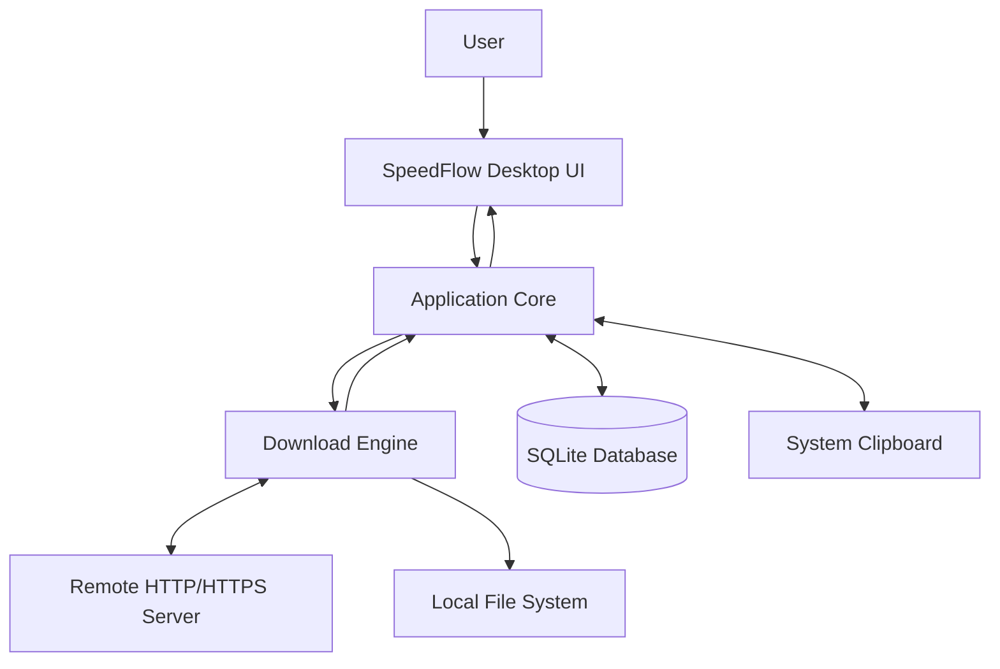
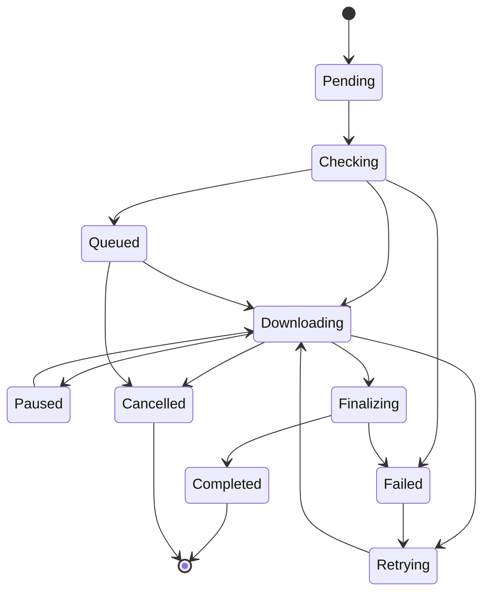

# Software Requirements Specification (SRS)
## SpeedFlow — Desktop Download Manager & Accelerator

**Version:** 0.1  
**Prepared by:** SpeedFlow Development Team  
**Organization:** Independent Software Project  
**Date Modified:** 2026-11-03  
**Document Status:** Initial Draft

---

## Table of Contents

1. Introduction
   - 1.1 Document Purpose
   - 1.2 Product Scope
   - 1.3 Definitions, Acronyms, and Abbreviations
   - 1.4 References
   - 1.5 Document Overview
2. Product Overview
   - 2.1 Product Perspective
   - 2.2 Product Functions
   - 2.3 Product Constraints
   - 2.4 User Characteristics
   - 2.5 Assumptions and Dependencies
   - 2.6 Apportioning of Requirements
3. Requirements
   - 3.1 External Interfaces
   - 3.2 Functional
   - 3.3 Quality of Service
   - 3.4 Compliance
   - 3.5 Design and Implementation
   - 3.6 AI/ML
4. Verification
5. Appendixes

---

## Revision History

| Name | Date | Reason For Changes | Version |
|---|---|---|---|
| SpeedFlow Development Team | 2026-11-03 | Initial SRS creation | 0.1 |

---

# 1. Introduction

This document specifies the software requirements for SpeedFlow, a desktop application designed to manage and accelerate internet file downloads.

SpeedFlow focuses on providing an efficient downloading experience, particularly for large files, through parallel connections, download recovery, queue management, and real-time monitoring.

This document defines the product scope, expected behavior, functional requirements, quality attributes, technical constraints, and verification criteria.

### 1.1 Document Purpose

The purpose of this Software Requirements Specification is to establish a clear and testable definition of SpeedFlow's requirements before implementation begins.

This document serves as the primary reference for developers, designers, testers, and AI coding agents involved in the development lifecycle.

It defines what SpeedFlow must do and the quality standards it must satisfy, without prescribing every internal implementation detail.

The SRS will be used to:
- Guide application architecture and technical decisions.
- Define the functional scope of the initial release.
- Provide implementation references for development tasks.
- Establish measurable acceptance criteria.
- Support testing, debugging, and future product improvements.

### 1.2 Product Scope

SpeedFlow is a native desktop Download Manager and Download Accelerator intended to provide users with a more efficient way to download files from the internet.

The primary objective is to optimize file downloads, especially large files, by utilizing parallel HTTP connections when supported by the remote server.

SpeedFlow will provide a centralized interface for managing downloads, monitoring transfer progress, recovering interrupted downloads, and organizing downloaded files.

**In Scope:**

- Download files directly from HTTP and HTTPS URLs.
- Accelerate supported downloads using parallel HTTP Range Requests.
- Pause, resume, and cancel downloads.
- Automatically retry interrupted downloads.
- Manage multiple downloads through a queue.
- Monitor download speed and progress in real time.
- Configure parallel connection limits.
- Limit download bandwidth.
- Detect copied download URLs through clipboard monitoring.
- Automatically categorize downloaded files.
- Maintain download history using local storage.
- Verify downloaded file integrity using supported checksums.
- Provide download scheduling.
- Provide desktop notifications.
- Support light and dark themes.

**Out of Scope for Initial Release:**

- Cloud-based file storage.
- User accounts and cloud synchronization.
- Built-in torrent or BitTorrent functionality.
- DRM circumvention.
- Unauthorized downloading of protected media.
- Browser extensions and automatic browser interception.
- Remote download management through mobile applications.
- Automatic download extraction and installation of downloaded software.

Browser integration may be considered for a future release.

### 1.3 Definitions, Acronyms, and Abbreviations

| Term | Definition |
|---|---|
| API | Application Programming Interface |
| Async | Asynchronous execution of operations |
| Bandwidth | Maximum data transfer capacity of a network connection |
| Checksum | A calculated value used to verify data integrity |
| Clipboard Monitor | A feature that detects copied URLs |
| Download Accelerator | A system that attempts to improve download throughput through parallel connections |
| Download Queue | A collection of downloads waiting to be processed |
| ETag | HTTP entity tag used to identify a specific version of a resource |
| HTTP | Hypertext Transfer Protocol |
| HTTPS | HTTP Secure |
| HTTP Range Request | An HTTP request used to retrieve a specific byte range of a resource |
| Multi-connection Download | Downloading different portions of a file through multiple connections |
| Parallel Connection | An independent network connection used to download a file segment |
| Resume | Continuing an interrupted download |
| Segment | A portion of a file downloaded independently |
| SQLite | Embedded relational database |
| Slint | Declarative GUI framework used to build the application interface |
| SRS | Software Requirements Specification |
| Tokio | Asynchronous runtime for Rust |
| URL | Uniform Resource Locator |
| UI | User Interface |
| Rust | Programming language used to implement SpeedFlow |

### 1.4 References

The following references provide technical guidance for the development of SpeedFlow.

| Reference | Owner | Type | Location |
|---|---|---|---|
| Rust Documentation | Rust Project | Informative | https://doc.rust-lang.org/ |
| Slint Documentation | Slint | Informative | https://docs.slint.dev/ |
| Tokio Documentation | Tokio Project | Informative | https://tokio.rs/ |
| Reqwest Documentation | Reqwest Project | Informative | https://docs.rs/reqwest/ |
| SQLx Documentation | SQLx Project | Informative | https://docs.rs/sqlx/ |
| SQLite Documentation | SQLite | Informative | https://www.sqlite.org/docs.html |
| HTTP Semantics (RFC 9110) | IETF | Informative | https://www.rfc-editor.org/rfc/rfc9110 |
| HTTP Range Requests (RFC 9110, Section 14) | IETF | Informative | https://www.rfc-editor.org/rfc/rfc9110#section-14 |
| Software Requirements Specification Template | Project Owner | Structural Reference | srs-template(5).md |

Technical implementation must follow applicable protocol specifications and the official documentation of the selected dependencies.

### 1.5 Document Overview

This document is organized into five major sections.

- **Section 1 — Introduction:** Describes the purpose, scope, terminology, and references.
- **Section 2 — Product Overview:** Explains the product context, core capabilities, constraints, and development priorities.
- **Section 3 — Requirements:** Defines the functional, interface, performance, security, reliability, and implementation requirements.
- **Section 4 — Verification:** Defines how SpeedFlow requirements will be tested and validated.
- **Section 5 — Appendixes:** Provides supplementary technical information and terminology.

Requirements use unique identifiers to support traceability between implementation and testing.

---

# 2. Product Overview

### 2.1 Product Perspective

SpeedFlow is a standalone desktop application that operates independently of web browsers.

It acts as an intermediary between the user and remote file servers. Users provide a download URL, and SpeedFlow handles the download process, including connection management, progress tracking, file writing, and recovery.

The application will use a modular architecture consisting of:

1. **Presentation Layer**
   - Displays the application interface.
   - Provides download controls and settings.
   - Displays real-time download information.

2. **Application Core**
   - Coordinates download tasks.
   - Manages download states.
   - Handles queues and scheduling.
   - Communicates with the UI.

3. **Download Engine**
   - Performs HTTP and HTTPS requests.
   - Detects server capabilities.
   - Manages parallel download segments.
   - Handles retries and download recovery.
   - Writes downloaded data to disk.

4. **Storage Layer**
   - Stores download metadata.
   - Maintains download history.
   - Stores application settings and queue information.

5. **System Integration Layer**
   - Provides clipboard monitoring.
   - Handles file system interactions.
   - Provides desktop notifications and system integration.

#### High-Level System Context



SpeedFlow will not operate its own file hosting infrastructure. All downloaded content will originate from external servers specified by the user.

### 2.2 Product Functions

SpeedFlow provides the following major functional areas:

**1. URL-Based Downloading**
- Accept direct HTTP and HTTPS download URLs.
- Retrieve file information when available.
- Allow users to specify the output filename and destination.

**2. Download Acceleration**
- Detect whether the remote server supports byte-range requests.
- Divide supported files into multiple segments.
- Download segments concurrently.
- Combine segments into the final file.
- Fall back to a single connection when acceleration is unavailable.

**3. Download Management**
- Pause, resume, cancel, and retry downloads.
- Track download states.
- Support multiple simultaneous download tasks.

**4. Queue Management**
- Create and manage download queues.
- Configure maximum simultaneous downloads.
- Support download priorities.
- Start the next queued download when a slot becomes available.

**5. Download Monitoring**
- Display real-time download speed.
- Display downloaded size and total size.
- Display estimated remaining time when calculable.
- Provide download speed history graphs.

**6. File Organization**
- Categorize downloads by file extension.
- Allow custom download destinations.
- Detect duplicate download entries.

**7. Smart Utilities**
- Monitor clipboard URLs.
- Schedule downloads.
- Limit download bandwidth.
- Automatically retry recoverable failures.

**8. Application Preferences**
- Configure parallel connections.
- Configure default download folders.
- Select light or dark themes.
- Configure notifications and startup behavior.

### 2.3 Product Constraints

The following constraints apply to SpeedFlow.

**Technology Constraints**

- The application core must be implemented using Rust.
- The graphical interface must use Slint.
- Tokio must be used as the asynchronous runtime.
- Reqwest must be used as the primary HTTP client.
- SQLite must be used for persistent local application data.
- SQLx must be used as the database access layer.

**Network Constraints**

- Parallel downloading depends on remote server support for HTTP Range Requests.
- Some servers may reject multiple connections or limit request rates.
- Some servers may require authentication or temporary URL parameters.
- Download acceleration cannot exceed the effective limitations of the user's network, server, or storage device.
- The application must not claim guaranteed acceleration.

**File System Constraints**

- Downloaded files must be stored in locations accessible to the application.
- Temporary segment files must be managed safely.
- The application must handle insufficient disk space.
- The application must avoid exposing incomplete files as completed downloads.

**Platform Constraints**

- The initial target operating system remains to be confirmed.
- The architecture should avoid unnecessary operating-system-specific dependencies.
- OS-specific integrations must be isolated behind suitable abstractions.

### 2.4 User Characteristics

SpeedFlow is designed for general desktop users.

| User Class | Characteristics | Goals |
|---|---|---|
| General Users | Basic computer and internet knowledge | Download files easily |
| Power Users | Frequently download large files | Optimize download speed and manage multiple tasks |
| Technical Users | Familiar with network and download settings | Configure connections, retries, and bandwidth |
| Developers and Testers | Familiar with software development and testing | Validate functionality and troubleshoot issues |

Users are not required to understand HTTP protocols or network programming to use the basic download functionality.

Advanced configuration options should remain accessible without making the default interface complicated.

### 2.5 Assumptions and Dependencies

**Assumptions**

1. Users have an active internet connection.
2. Users have permission to download the requested content.
3. Remote servers expose downloadable resources through HTTP or HTTPS.
4. Users have sufficient disk space for downloaded files.
5. Users can access the destination directory.
6. The initial application does not require cloud services or user authentication.

**Dependencies**

| Dependency | Purpose | Impact if Unavailable |
|---|---|---|
| Rust Toolchain | Application development and compilation | Application cannot be built |
| Slint | Desktop UI | Interface cannot be compiled |
| Tokio | Async execution | Download processing unavailable |
| Reqwest | HTTP communication | Network downloads unavailable |
| SQLite | Local persistence | History and settings cannot be persisted |
| SQLx | Database interaction | Storage operations unavailable |
| Operating System APIs | Clipboard and notifications | Related integrations may be unavailable |

The application should handle unavailable optional integrations gracefully.

### 2.6 Apportioning of Requirements

Requirements are allocated across the following development increments.

| Increment | Scope | Priority |
|---|---|---|
| Release 1 — Foundation | Project setup, UI foundation, URL downloads | Critical |
| Release 2 — Download Engine | Parallel segments, pause, resume, retries | Critical |
| Release 3 — Management | Queue, history, database persistence | Critical |
| Release 4 — Optimization | Speed limiter, connection configuration, monitoring | High |
| Release 5 — Smart Utilities | Clipboard monitor, categorization, scheduler | High |
| Release 6 — Polish | Notifications, themes, packaging, stability improvements | High |
| Future Release | Browser extensions and browser interception | Deferred |

---

# 3. Requirements

This section defines the verifiable requirements of SpeedFlow.

The keywords have the following meanings:

- **Shall:** Mandatory requirement.
- **Should:** Recommended requirement.
- **May:** Optional requirement.

Each requirement must have a unique identifier and measurable acceptance criteria.

## 3.1 External Interfaces

### 3.1.1 User Interfaces

The application must provide a desktop interface that is simple, modern, and focused on download management.

The interface should use a consistent component system and support light and dark themes.

**Main Interface Areas**

1. Overview Dashboard
2. All Downloads
3. Active Downloads
4. Completed Downloads
5. Download Queue
6. Scheduler
7. Categories
8. Settings

**Primary UI Components**

- URL input field.
- Download action button.
- Download progress indicators.
- Download speed indicators.
- Pause, resume, cancel, and retry controls.
- Download status labels.
- Queue management controls.
- Settings forms.
- Notifications and confirmation dialogs.

**UI Behavior**

- The application shall provide clear feedback when a download starts.
- The application shall display an appropriate empty state when no downloads exist.
- The application shall display understandable error messages.
- The application shall confirm destructive actions when appropriate.
- The interface shall remain responsive while downloads are running.
- Download progress shall be reflected without requiring manual refresh.
- Long filenames shall not break the layout.

**Initial Keyboard Shortcuts**

| Shortcut | Action |
|---|---|
| Ctrl + N | Add new download |
| Ctrl + V | Paste URL into the download input |
| Ctrl + Q | Exit application |
| Delete | Remove selected download entry |
| Space | Pause or resume selected download, when supported by the current view |

Final shortcuts may be adjusted according to platform conventions.

### 3.1.2 Hardware Interfaces

SpeedFlow interacts with standard desktop hardware through the operating system.

Required hardware resources:

- CPU for concurrent network and file operations.
- RAM for application execution and buffering.
- Network adapter for internet communication.
- Storage device for downloaded files and application data.
- Display device for the graphical interface.
- Keyboard and pointing device for user interaction.

The application does not require specialized hardware.

### 3.1.3 Software Interfaces

| Interface | Technology / Protocol | Purpose |
|---|---|---|
| GUI Framework | Slint | User interface |
| Application Runtime | Tokio | Asynchronous execution |
| HTTP Client | Reqwest | HTTP and HTTPS requests |
| Network Protocol | HTTP/HTTPS | Remote file downloading |
| Database | SQLite | Persistent application data |
| Database Access | SQLx | Database queries |
| Serialization | Serde | Structured data serialization |
| Logging | tracing | Application diagnostics |
| File System | Operating System APIs | File creation and management |
| Clipboard | Operating System APIs | Clipboard monitoring |
| Notifications | Operating System APIs | Desktop notifications |

The download engine shall support standard HTTP redirects according to configured redirect policies.

The application must correctly handle HTTP status codes, including:

- 200 OK
- 206 Partial Content
- 301 and 302 redirects
- 304 Not Modified, where applicable
- 403 Forbidden
- 404 Not Found
- 416 Range Not Satisfiable
- 429 Too Many Requests
- 500-series server errors

Authentication and custom request headers may be supported for direct downloads where the user has the necessary authorization.

## 3.2 Functional

### 3.2.1 URL-Based Downloading

**REQ-FUNC-001 — Add Download Using URL**

- ID: REQ-FUNC-001
- Title: Add Download Using URL
- Statement: The system shall allow users to start a download by providing a valid HTTP or HTTPS URL.
- Rationale: URL-based downloading is the primary interaction of SpeedFlow.
- Acceptance Criteria:
  - The user can enter a URL.
  - The application validates the URL format.
  - The application starts a download for a valid URL.
  - Invalid URLs produce a readable error.
- Verification Method: Test
- More Information: Core download functionality.

**REQ-FUNC-002 — Retrieve File Information**

- ID: REQ-FUNC-002
- Title: Retrieve File Information
- Statement: The system shall attempt to retrieve available file metadata before downloading.
- Rationale: Users should know what they are downloading.
- Acceptance Criteria:
  - The application retrieves the filename when available.
  - The application retrieves content length when available.
  - The application identifies the content type when available.
  - The application handles unavailable metadata without crashing.
- Verification Method: Test
- More Information: HTTP metadata retrieval.

**REQ-FUNC-003 — Configure Download Destination**

- ID: REQ-FUNC-003
- Title: Configure Download Destination
- Statement: The system shall allow users to select the destination directory and filename for downloaded files.
- Rationale: Users need control over file organization.
- Acceptance Criteria:
  - Users can select a destination directory.
  - Users can edit the output filename.
  - Invalid or inaccessible destinations produce an error.
- Verification Method: Demonstration

### 3.2.2 Download Acceleration

**REQ-FUNC-004 — Detect HTTP Range Support**

- ID: REQ-FUNC-004
- Title: Detect HTTP Range Support
- Statement: The system shall determine whether the remote server supports partial content retrieval before enabling segmented downloading.
- Rationale: Parallel downloads require the ability to retrieve separate portions of a resource.
- Acceptance Criteria:
  - The application checks server response information and validates range behavior.
  - The application does not assume that an advertised Accept-Ranges header guarantees successful range retrieval.
  - Unsupported servers use single-connection downloading.
  - Failed capability detection does not prevent normal downloading when possible.
- Verification Method: Test

**REQ-FUNC-005 — Parallel Segment Downloading**

- ID: REQ-FUNC-005
- Title: Parallel Segment Downloading
- Statement: The system shall support downloading a file through multiple concurrent HTTP range requests when the server supports compatible range retrieval.
- Rationale: Parallel connections are the primary acceleration mechanism of SpeedFlow.
- Acceptance Criteria:
  - The system can divide a supported file into multiple non-overlapping byte ranges.
  - Each segment is downloaded through an independent request.
  - The downloaded segments cover the intended file range without gaps or overlaps.
  - The number of connections does not exceed the configured limit.
  - All segments are written to their correct positions.
- Verification Method: Test
- More Information: Download engine and segment manager.

**REQ-FUNC-006 — Configure Parallel Connections**

- ID: REQ-FUNC-006
- Title: Configure Parallel Connections
- Statement: The system shall allow users to configure the maximum number of parallel connections used for a download.
- Rationale: Users need control over download behavior and network resource usage.
- Acceptance Criteria:
  - Users can select a connection limit from 1 to 16.
  - The default value shall be 8.
  - The application respects the configured limit.
  - Unsupported parallel downloading falls back to one connection.
- Verification Method: Test
- More Information: Default values may be revised after performance testing.

**REQ-FUNC-007 — Combine Download Segments**

- ID: REQ-FUNC-007
- Title: Combine Download Segments
- Statement: The system shall correctly assemble all successfully downloaded segments into a single output file.
- Rationale: Parallel segments must produce a valid final file.
- Acceptance Criteria:
  - Every segment is written to its assigned byte position.
  - The final file size matches the expected resource size when known.
  - Missing or failed segments prevent the download from being marked as completed.
  - The final file becomes visible as completed only after successful finalization.
- Verification Method: Test

**REQ-FUNC-008 — Single-Connection Fallback**

- ID: REQ-FUNC-008
- Title: Single-Connection Fallback
- Statement: The system shall support normal single-connection downloading when parallel downloading is unsupported or unsuitable.
- Rationale: SpeedFlow must remain useful across different servers.
- Acceptance Criteria:
  - The application can download files without range support.
  - The application switches to a safe fallback when segmented downloading cannot continue.
  - The UI identifies when acceleration is unavailable.
- Verification Method: Test

### 3.2.3 Download Controls

**REQ-FUNC-009 — Pause Download**

- ID: REQ-FUNC-009
- Title: Pause Download
- Statement: The system shall allow users to pause an active download.
- Rationale: Users need control over active transfers.
- Acceptance Criteria:
  - Active download requests are stopped or suspended safely.
  - Download metadata and completed segment information are retained.
  - The download status changes to Paused.
- Verification Method: Test

**REQ-FUNC-010 — Resume Download**

- ID: REQ-FUNC-010
- Title: Resume Download
- Statement: The system shall allow users to resume a previously paused or interrupted download when the remote resource remains compatible.
- Rationale: Users should not need to restart large downloads unnecessarily.
- Acceptance Criteria:
  - Completed segments are not downloaded again unnecessarily.
  - Incomplete segments can be requested again.
  - Resource identity is validated when possible.
  - If the remote file has changed, the application must prevent unsafe segment combination and request a restart.
- Verification Method: Test

**REQ-FUNC-011 — Cancel Download**

- ID: REQ-FUNC-011
- Title: Cancel Download
- Statement: The system shall allow users to cancel active and queued downloads.
- Rationale: Users must be able to stop unwanted transfers.
- Acceptance Criteria:
  - Active network operations are terminated safely.
  - Temporary data is handled according to user settings.
  - The download status is updated to Cancelled.
- Verification Method: Test

**REQ-FUNC-012 — Retry Failed Download**

- ID: REQ-FUNC-012
- Title: Retry Failed Download
- Statement: The system shall allow users to retry failed downloads.
- Rationale: Temporary network failures should not permanently prevent downloads.
- Acceptance Criteria:
  - Users can manually retry failed tasks.
  - Recoverable errors preserve compatible progress.
  - Non-recoverable errors provide an explanation.
- Verification Method: Test

**REQ-FUNC-013 — Automatic Retry**

- ID: REQ-FUNC-013
- Title: Automatic Retry
- Statement: The system shall automatically retry recoverable download failures according to configurable retry policies.
- Rationale: The application should recover from temporary network interruptions.
- Acceptance Criteria:
  - The default maximum retry count is 5.
  - Retry attempts use exponential backoff with a maximum delay.
  - Permanent client errors are not retried indefinitely.
  - HTTP 429 responses respect Retry-After when available.
  - Users can disable automatic retry.
- Verification Method: Test

### 3.2.4 Download Queue

**REQ-FUNC-014 — Manage Download Queue**

- ID: REQ-FUNC-014
- Title: Manage Download Queue
- Statement: The system shall maintain a queue of downloads waiting to start.
- Rationale: Users need to organize multiple downloads.
- Acceptance Criteria:
  - Users can add downloads to the queue.
  - Users can remove queued downloads.
  - Users can reorder queued downloads.
  - The next task starts when an execution slot becomes available.
- Verification Method: Test

**REQ-FUNC-015 — Configure Simultaneous Downloads**

- ID: REQ-FUNC-015
- Title: Configure Simultaneous Downloads
- Statement: The system shall allow users to configure the maximum number of download tasks that may run simultaneously.
- Rationale: Users need to balance network utilization and system resource usage.
- Acceptance Criteria:
  - The default simultaneous task limit is 3.
  - The application respects the configured limit.
  - Queued tasks remain waiting until a slot becomes available.
- Verification Method: Test

**REQ-FUNC-016 — Download Priority**

- ID: REQ-FUNC-016
- Title: Download Priority
- Statement: The system should allow users to assign priorities to queued downloads.
- Rationale: Important downloads should be processed before lower-priority tasks.
- Acceptance Criteria:
  - Users can assign priority levels.
  - The queue processes eligible tasks according to priority.
  - Running tasks are not interrupted unexpectedly when priority changes.
- Verification Method: Test

**REQ-FUNC-017 — Batch Download**

- ID: REQ-FUNC-017
- Title: Batch Download
- Statement: The system shall support adding multiple URLs to the download queue in a single operation.
- Rationale: Users should be able to manage multiple download links efficiently.
- Acceptance Criteria:
  - Users can provide multiple URLs.
  - Each valid URL becomes an individual download task.
  - Invalid URLs are reported individually.
- Verification Method: Test

### 3.2.5 Download Monitoring

**REQ-FUNC-018 — Real-Time Download Progress**

- ID: REQ-FUNC-018
- Title: Real-Time Download Progress
- Statement: The system shall display the current progress of each active download.
- Rationale: Users need visibility into download status.
- Acceptance Criteria:
  - The UI displays downloaded bytes.
  - The UI displays total bytes when known.
  - The UI displays completion percentage when calculable.
  - Unknown file sizes are represented appropriately.
- Verification Method: Demonstration

**REQ-FUNC-019 — Download Speed Monitoring**

- ID: REQ-FUNC-019
- Title: Download Speed Monitoring
- Statement: The system shall calculate and display the current download speed.
- Rationale: Users need to monitor download performance.
- Acceptance Criteria:
  - Download speed is displayed in an appropriate unit.
  - Speed updates periodically.
  - Speed returns to zero when a download is paused or stopped.
- Verification Method: Test

**REQ-FUNC-020 — Estimated Time Remaining**

- ID: REQ-FUNC-020
- Title: Estimated Time Remaining
- Statement: The system should calculate estimated remaining time when sufficient transfer information is available.
- Rationale: Users need an estimate of download completion.
- Acceptance Criteria:
  - Remaining time is calculated from remaining bytes and recent average speed.
  - The UI does not display misleading estimates when speed is zero or unknown.
- Verification Method: Test

**REQ-FUNC-021 — Download Speed Graph**

- ID: REQ-FUNC-021
- Title: Download Speed Graph
- Statement: The system should provide a graphical representation of download speed over time.
- Rationale: Users can better understand transfer performance.
- Acceptance Criteria:
  - The graph updates during active downloads.
  - The graph displays historical speed samples.
  - The graph does not cause excessive UI updates.
- Verification Method: Demonstration

### 3.2.6 Bandwidth Management

**REQ-FUNC-022 — Download Speed Limiter**

- ID: REQ-FUNC-022
- Title: Download Speed Limiter
- Statement: The system shall allow users to limit the maximum download bandwidth used by SpeedFlow.
- Rationale: Users may need to reserve bandwidth for other activities.
- Acceptance Criteria:
  - Users can configure a maximum download speed.
  - The limit applies to the total application download traffic.
  - Users can disable the limit.
- Verification Method: Test

### 3.2.7 Smart Utilities

**REQ-FUNC-023 — Clipboard URL Detection**

- ID: REQ-FUNC-023
- Title: Clipboard URL Detection
- Statement: The system should detect copied HTTP and HTTPS URLs and offer users the option to download them.
- Rationale: Users should be able to add downloads without manually pasting every URL.
- Acceptance Criteria:
  - Clipboard monitoring can be enabled or disabled.
  - The application recognizes supported URL formats.
  - A download prompt is displayed rather than automatically starting a download.
  - Duplicate prompts are avoided.
- Verification Method: Demonstration

**REQ-FUNC-024 — Smart File Categorization**

- ID: REQ-FUNC-024
- Title: Smart File Categorization
- Statement: The system should automatically categorize downloaded files based on file extension and available metadata.
- Rationale: Downloaded files should be easier to organize.
- Acceptance Criteria:
  - Common file types are assigned to categories.
  - Unknown extensions are assigned to a general category.
  - Users can change the destination folder for each category.
- Verification Method: Test

**REQ-FUNC-025 — Duplicate Download Detection**

- ID: REQ-FUNC-025
- Title: Duplicate Download Detection
- Statement: The system should identify potentially duplicate download tasks based on URL and available file metadata.
- Rationale: Users should be informed when they attempt to download the same resource repeatedly.
- Acceptance Criteria:
  - The application checks existing download records.
  - Potential duplicates generate a notification.
  - Users can still choose to download again.
- Verification Method: Test

**REQ-FUNC-026 — Download Scheduler**

- ID: REQ-FUNC-026
- Title: Download Scheduler
- Statement: The system should allow users to schedule downloads for a specified date and time.
- Rationale: Users may prefer downloads to start at a particular time.
- Acceptance Criteria:
  - Users can configure a scheduled start time.
  - Scheduled tasks remain persisted after application restart.
  - Tasks start when the scheduled time is reached and the application is running.
  - Missed scheduled tasks are handled according to user preferences.
- Verification Method: Test

**REQ-FUNC-027 — Download History**

- ID: REQ-FUNC-027
- Title: Download History
- Statement: The system shall maintain a local history of download tasks.
- Rationale: Users need to review previous downloads.
- Acceptance Criteria:
  - Completed, failed, and cancelled tasks are recorded.
  - Users can search or filter historical entries.
  - Users can clear selected history records.
  - History remains available after application restart.
- Verification Method: Test

**REQ-FUNC-028 — Integrity Verification**

- ID: REQ-FUNC-028
- Title: Integrity Verification
- Statement: The system should support verifying downloaded files using available checksums.
- Rationale: Users need confidence that downloaded files have not been corrupted.
- Acceptance Criteria:
  - The application supports SHA-256 verification.
  - Users can enter an expected checksum.
  - The application reports whether the calculated checksum matches.
  - A checksum mismatch is clearly reported.
- Verification Method: Test

**REQ-FUNC-029 — Desktop Notifications**

- ID: REQ-FUNC-029
- Title: Desktop Notifications
- Statement: The system should provide desktop notifications for important download events.
- Rationale: Users should know when downloads complete or fail.
- Acceptance Criteria:
  - Notifications are displayed when downloads complete.
  - Notifications can be disabled.
  - Notification failures do not interrupt downloads.
- Verification Method: Demonstration

### 3.2.8 Application Settings

**REQ-FUNC-030 — Application Preferences**

- ID: REQ-FUNC-030
- Title: Application Preferences
- Statement: The system shall provide a settings interface for configuring application behavior.
- Rationale: Users need control over application preferences.
- Acceptance Criteria:
  - Users can configure download defaults.
  - Users can configure parallel connection limits.
  - Users can configure simultaneous download limits.
  - Users can configure retry behavior.
  - Settings persist after application restart.
- Verification Method: Test

**REQ-FUNC-031 — Theme Selection**

- ID: REQ-FUNC-031
- Title: Theme Selection
- Statement: The system shall support light and dark interface themes.
- Rationale: Users should be able to select their preferred appearance.
- Acceptance Criteria:
  - Users can select light mode.
  - Users can select dark mode.
  - Users can select system-based theme behavior if supported by the platform.
  - Theme preferences persist after restart.
- Verification Method: Demonstration

**REQ-FUNC-032 — Open Downloaded File**

- ID: REQ-FUNC-032
- Title: Open Downloaded File
- Statement: The system shall allow users to open a completed file using the operating system's default associated application.
- Rationale: Users should be able to access downloaded content directly.
- Acceptance Criteria:
  - Completed files can be opened.
  - Missing files generate an appropriate error.
  - The application does not attempt to execute files automatically after downloading.
- Verification Method: Test

**REQ-FUNC-033 — Reveal File in Folder**

- ID: REQ-FUNC-033
- Title: Reveal File in Folder
- Statement: The system shall allow users to open the containing directory of a downloaded file.
- Rationale: Users need convenient access to downloaded files.
- Acceptance Criteria:
  - The operating system's file manager opens the correct directory.
  - The application handles missing destination paths gracefully.
- Verification Method: Test

## 3.3 Quality of Service

### 3.3.1 Performance

**REQ-PERF-001 — UI Responsiveness**

- ID: REQ-PERF-001
- Title: UI Responsiveness
- Statement: The system shall keep the graphical interface responsive while downloads are active.
- Rationale: Network operations must not block the user interface.
- Acceptance Criteria:
  - Normal UI interactions should complete within 100 milliseconds under the defined test environment.
  - Download operations must not execute as blocking work on the UI thread.
  - The interface remains usable during concurrent downloads.
- Verification Method: Test

**REQ-PERF-002 — Download Concurrency**

- ID: REQ-PERF-002
- Title: Download Concurrency
- Statement: The system shall support the configured number of parallel connections without exceeding its configured limits.
- Rationale: Connection concurrency is central to the acceleration feature.
- Acceptance Criteria:
  - The engine respects the configured per-download connection limit.
  - The engine respects the simultaneous task limit.
  - No uncontrolled connection creation occurs.
- Verification Method: Test

**REQ-PERF-003 — Resource Utilization**

- ID: REQ-PERF-003
- Title: Resource Utilization
- Statement: The system should minimize unnecessary CPU and memory consumption during idle and active states.
- Rationale: SpeedFlow is intended to be a lightweight desktop application.
- Acceptance Criteria:
  - Idle CPU utilization should remain below 2% on the reference test machine.
  - Idle memory usage should target below 150 MB.
  - Memory usage should remain bounded during large downloads.
  - The application must not load entire large files into memory.
- Verification Method: Analysis and Test
- More Information: Targets are provisional and must be validated on the selected operating systems and hardware.

**REQ-PERF-004 — Download Buffering**

- ID: REQ-PERF-004
- Title: Download Buffering
- Statement: The system shall use bounded buffering for network-to-disk transfers.
- Rationale: Large files must not require memory proportional to their total size.
- Acceptance Criteria:
  - Data is streamed to disk.
  - Memory consumption does not grow linearly with downloaded file size.
  - Buffer sizes are controlled by the download engine.
- Verification Method: Analysis and Test

**REQ-PERF-005 — Acceleration Benchmark**

- ID: REQ-PERF-005
- Title: Acceleration Benchmark
- Statement: The system shall provide a repeatable benchmark procedure to compare single-connection and parallel-connection downloads.
- Rationale: Acceleration claims must be based on measurable results.
- Acceptance Criteria:
  - Both modes can be tested against the same server and resource.
  - The benchmark records throughput, duration, and error rate.
  - Benchmark reports identify server and network limitations.
  - No fixed speed improvement is guaranteed.
- Verification Method: Test

### 3.3.2 Security

**REQ-SEC-001 — Secure HTTP Communication**

- ID: REQ-SEC-001
- Title: Secure HTTP Communication
- Statement: The system shall support HTTPS with standard certificate validation.
- Rationale: Download communication must be protected against common network attacks.
- Acceptance Criteria:
  - Invalid TLS certificates are rejected by default.
  - Certificate validation cannot be silently disabled.
  - HTTPS requests use supported secure protocol configurations.
- Verification Method: Test

**REQ-SEC-002 — URL Validation**

- ID: REQ-SEC-002
- Title: URL Validation
- Statement: The system shall validate download URLs before initiating network requests.
- Rationale: Malformed or unsafe URLs must not be processed unexpectedly.
- Acceptance Criteria:
  - Only HTTP and HTTPS schemes are supported for normal downloads.
  - Unsupported protocols are rejected.
  - Malformed URLs generate readable errors.
  - Redirect targets are validated according to the application's network security policy.
- Verification Method: Test

**REQ-SEC-003 — Sensitive Information Protection**

- ID: REQ-SEC-003
- Title: Sensitive Information Protection
- Statement: The system shall avoid exposing sensitive URL parameters, authorization headers, and credentials in logs or user-visible diagnostics.
- Rationale: Download URLs may contain temporary access tokens.
- Acceptance Criteria:
  - Sensitive headers are not written to ordinary logs.
  - Credential-bearing URLs are redacted in diagnostics where practical.
  - Secrets are not stored in plaintext logs.
- Verification Method: Inspection and Test

**REQ-SEC-004 — File Path Safety**

- ID: REQ-SEC-004
- Title: File Path Safety
- Statement: The system shall validate destination paths and filenames before writing downloaded data.
- Rationale: Unsafe file paths may result in unintended file modification.
- Acceptance Criteria:
  - Path traversal attempts are rejected.
  - Invalid filenames are handled safely.
  - Existing files are not overwritten without the configured user approval policy.
  - Temporary files are created in controlled locations.
- Verification Method: Test

**REQ-SEC-005 — Local Network Request Protection**

- ID: REQ-SEC-005
- Title: Local Network Request Protection
- Statement: The system should prevent unintended requests to loopback, private, link-local, and other restricted network destinations.
- Rationale: User-provided URLs and redirects can potentially be abused to access local resources.
- Acceptance Criteria:
  - Restricted destinations are identified.
  - Redirect destinations are checked.
  - Access to restricted destinations requires explicit user authorization when such access is supported.
- Verification Method: Security Test

**REQ-SEC-006 — Dependency Security**

- ID: REQ-SEC-006
- Title: Dependency Security
- Statement: The system should use maintained dependencies and provide a process for identifying known dependency vulnerabilities.
- Rationale: Third-party libraries may introduce security risks.
- Acceptance Criteria:
  - Dependency versions are tracked.
  - Security advisories are reviewed during maintenance.
  - Unnecessary dependencies are avoided.
- Verification Method: Inspection

### 3.3.3 Reliability

**REQ-REL-001 — Download Recovery**

- ID: REQ-REL-001
- Title: Download Recovery
- Statement: The system shall preserve sufficient download state to recover interrupted downloads when the remote resource remains compatible.
- Rationale: Large downloads must be recoverable after unexpected interruptions.
- Acceptance Criteria:
  - Download metadata is persisted.
  - Completed segment information is retained.
  - Recovery validates remote resource identity when possible.
  - Incompatible resources trigger a safe restart rather than unsafe merging.
- Verification Method: Test

**REQ-REL-002 — Segment Integrity**

- ID: REQ-REL-002
- Title: Segment Integrity
- Statement: The system shall validate segment boundaries and completion states before finalizing a file.
- Rationale: Incorrect segment assembly can corrupt downloaded files.
- Acceptance Criteria:
  - Each segment has a known byte range.
  - Overlapping or missing ranges are detected.
  - Finalization occurs only after all required ranges are complete.
- Verification Method: Test

**REQ-REL-003 — Database Recovery**

- ID: REQ-REL-003
- Title: Database Recovery
- Statement: The system shall handle database errors without silently corrupting application state.
- Rationale: Download history and task metadata must remain consistent.
- Acceptance Criteria:
  - Database errors are logged.
  - The application reports unavailable persistence operations.
  - Transactions are used for critical state changes.
  - Database recovery procedures are documented.
- Verification Method: Test

**REQ-REL-004 — Graceful Failure Handling**

- ID: REQ-REL-004
- Title: Graceful Failure Handling
- Statement: The system shall handle network, storage, and application errors without unexpected termination whenever recovery is possible.
- Rationale: Download failures must not compromise the entire application.
- Acceptance Criteria:
  - Failed downloads receive a meaningful status.
  - One failed download does not terminate unrelated downloads.
  - Insufficient disk space is reported.
  - Temporary files are handled according to recovery policy.
- Verification Method: Test

### 3.3.4 Availability

**REQ-AVAIL-001 — Local Application Availability**

- ID: REQ-AVAIL-001
- Title: Local Application Availability
- Statement: The system shall operate without requiring an external SpeedFlow server.
- Rationale: SpeedFlow is a standalone desktop application.
- Acceptance Criteria:
  - Core UI functions are available offline.
  - Download history and settings can be accessed without internet connectivity.
  - Network downloads report an offline state when connectivity is unavailable.
- Verification Method: Demonstration

**REQ-AVAIL-002 — Startup Recovery**

- ID: REQ-AVAIL-002
- Title: Startup Recovery
- Statement: The system shall identify unfinished download tasks when the application starts.
- Rationale: Users must be able to recover previous download sessions.
- Acceptance Criteria:
  - Interrupted tasks are restored from persistent metadata.
  - The user can resume eligible tasks.
  - Incompatible tasks are clearly marked.
- Verification Method: Test

### 3.3.5 Observability

**REQ-OBS-001 — Application Logging**

- ID: REQ-OBS-001
- Title: Application Logging
- Statement: The system shall maintain structured application logs for important operations and errors.
- Rationale: Logs support debugging and maintenance.
- Acceptance Criteria:
  - Logs include timestamps and severity levels.
  - Download failures include diagnostic context.
  - Sensitive information is redacted.
  - Logging can be configured to appropriate verbosity levels.
- Verification Method: Inspection

**REQ-OBS-002 — Download Diagnostics**

- ID: REQ-OBS-002
- Title: Download Diagnostics
- Statement: The system should provide diagnostic information for failed downloads.
- Rationale: Users and developers need to understand why a download failed.
- Acceptance Criteria:
  - Failure reasons are categorized where possible.
  - HTTP status information is recorded when available.
  - Retry attempts are traceable.
  - Diagnostic output does not expose credentials.
- Verification Method: Test

## 3.4 Compliance

**REQ-COMP-001 — Content Authorization**

- ID: REQ-COMP-001
- Title: Content Authorization
- Statement: The system shall be designed for downloading content that users are authorized to access and download.
- Rationale: The application must respect applicable content rights and access restrictions.
- Acceptance Criteria:
  - The application does not bypass DRM protections.
  - The application does not circumvent authentication or access restrictions.
  - The application does not claim authorization to download third-party content.
- Verification Method: Inspection

**REQ-COMP-002 — Third-Party Dependency Licensing**

- ID: REQ-COMP-002
- Title: Third-Party Dependency Licensing
- Statement: The system shall maintain records of third-party dependency licenses.
- Rationale: Open-source software distribution must respect dependency licenses.
- Acceptance Criteria:
  - Dependency licenses are reviewed.
  - Required license notices are included in distribution artifacts.
  - Dependencies with incompatible licensing terms are not included without approval.
- Verification Method: Inspection

**REQ-COMP-003 — User Privacy**

- ID: REQ-COMP-003
- Title: User Privacy
- Statement: The system shall keep download history and application preferences locally unless the user explicitly enables a future external integration.
- Rationale: SpeedFlow is intended to be privacy-conscious.
- Acceptance Criteria:
  - No mandatory user account is required.
  - No mandatory cloud synchronization is required.
  - Download history remains local.
  - Sensitive information is excluded from diagnostic logs.
- Verification Method: Inspection and Test

## 3.5 Design and Implementation

### 3.5.1 Installation

**REQ-INST-001 — Desktop Installation**

- ID: REQ-INST-001
- Title: Desktop Installation
- Statement: The system shall provide an installation or distribution package suitable for the selected target operating system.
- Rationale: Users need a straightforward installation process.
- Acceptance Criteria:
  - The package includes required application resources.
  - Installation instructions are provided.
  - The application can be launched after installation.
  - Uninstallation procedures are documented.
- Verification Method: Demonstration

**REQ-INST-002 — Local Data Storage**

- ID: REQ-INST-002
- Title: Local Data Storage
- Statement: The system shall store application configuration and database files in an appropriate user-specific application data directory.
- Rationale: Application data must be stored separately from installation files.
- Acceptance Criteria:
  - Database files are stored in an appropriate location.
  - User data is retained across application upgrades where compatible.
  - Uninstallation behavior for user data is documented.
- Verification Method: Inspection and Test

### 3.5.2 Build and Delivery

**REQ-BUILD-001 — Reproducible Build Configuration**

- ID: REQ-BUILD-001
- Title: Reproducible Build Configuration
- Statement: The system should use a controlled dependency configuration to support repeatable builds.
- Rationale: Consistent builds simplify debugging and release management.
- Acceptance Criteria:
  - Cargo.lock is maintained for application builds.
  - Dependency versions are tracked.
  - Build instructions are documented.
- Verification Method: Inspection

**REQ-BUILD-002 — Release Packaging**

- ID: REQ-BUILD-002
- Title: Release Packaging
- Statement: The system shall produce distributable application artifacts for supported platforms.
- Rationale: The application must be usable outside the development environment.
- Acceptance Criteria:
  - Release artifacts can be installed or executed on supported platforms.
  - Application version information is available.
  - Required runtime dependencies are documented.
- Verification Method: Demonstration

**REQ-BUILD-003 — Release Verification**

- ID: REQ-BUILD-003
- Title: Release Verification
- Statement: The system should verify release artifacts before distribution.
- Rationale: Users should receive valid and traceable application packages.
- Acceptance Criteria:
  - Release builds pass the required test suite.
  - Artifact checksums are generated.
  - Release notes are provided.
- Verification Method: Inspection and Test

### 3.5.3 Distribution

**REQ-DIST-001 — Standalone Distribution**

- ID: REQ-DIST-001
- Title: Standalone Distribution
- Statement: The system shall be distributable as a standalone desktop application without requiring a SpeedFlow-hosted backend service.
- Rationale: The application is intended to operate locally.
- Acceptance Criteria:
  - Core functionality works without a SpeedFlow cloud service.
  - Download operations communicate directly with remote file servers.
- Verification Method: Demonstration

### 3.5.4 Maintainability

**REQ-MAINT-001 — Modular Architecture**

- ID: REQ-MAINT-001
- Title: Modular Architecture
- Statement: The system shall separate presentation, application logic, download processing, storage, and system integration into distinct modules.
- Rationale: Modular code improves maintainability and testing.
- Acceptance Criteria:
  - UI components do not directly implement HTTP download logic.
  - Download engine functionality can be tested independently.
  - Database operations are separated from presentation components.
- Verification Method: Inspection

**REQ-MAINT-002 — Code Quality**

- ID: REQ-MAINT-002
- Title: Code Quality
- Statement: The project should follow consistent Rust coding conventions and formatting.
- Rationale: Consistent code improves collaboration and maintainability.
- Acceptance Criteria:
  - Rust code passes cargo fmt checks.
  - Clippy warnings are reviewed and resolved where appropriate.
  - Modules and public interfaces are documented.
- Verification Method: Inspection

**REQ-MAINT-003 — Documentation**

- ID: REQ-MAINT-003
- Title: Documentation
- Statement: The project shall maintain technical documentation for architecture, setup, and core modules.
- Rationale: Developers need a reliable reference when maintaining the application.
- Acceptance Criteria:
  - README.md documents project setup.
  - Architecture documentation describes major modules.
  - Download engine behavior is documented.
  - Configuration and testing instructions are documented.
- Verification Method: Inspection

### 3.5.5 Reusability

**REQ-REUSE-001 — Reusable Download Engine**

- ID: REQ-REUSE-001
- Title: Reusable Download Engine
- Statement: The download engine should be implemented as a modular component with minimal dependency on the graphical interface.
- Rationale: The engine may be reused by future applications or interfaces.
- Acceptance Criteria:
  - Download operations can be invoked through defined interfaces.
  - Engine tests do not require rendering the Slint interface.
  - Download state and events are exposed through suitable application interfaces.
- Verification Method: Inspection and Test

### 3.5.6 Portability

**REQ-PORT-001 — Platform Abstraction**

- ID: REQ-PORT-001
- Title: Platform Abstraction
- Statement: The system should isolate operating-system-specific functionality behind platform abstraction modules.
- Rationale: Future cross-platform support should not require rewriting the download engine.
- Acceptance Criteria:
  - Clipboard access is isolated.
  - Notifications are isolated.
  - File dialogs and system integrations are isolated.
  - Core download logic remains platform-independent.
- Verification Method: Inspection

**REQ-PORT-002 — Cross-Platform Readiness**

- ID: REQ-PORT-002
- Title: Cross-Platform Readiness
- Statement: The system architecture should support future Windows, Linux, and macOS builds where Slint and required dependencies provide compatible support.
- Rationale: Cross-platform expansion may be part of future product development.
- Acceptance Criteria:
  - Platform-specific code is documented.
  - No unnecessary hard-coded operating-system paths are used.
  - The core engine avoids platform-specific assumptions.
- Verification Method: Inspection

### 3.5.7 Cost

**REQ-COST-001 — No Mandatory Cloud Infrastructure**

- ID: REQ-COST-001
- Title: No Mandatory Cloud Infrastructure
- Statement: The system shall not require paid cloud infrastructure to provide its core downloading functionality.
- Rationale: SpeedFlow should remain cost-efficient to operate and maintain.
- Acceptance Criteria:
  - Core downloads work without a hosted backend.
  - Local storage is used for application data.
  - External paid services are not mandatory.
- Verification Method: Inspection

### 3.5.8 Deadline

**REQ-DEAD-001 — Incremental Development**

- ID: REQ-DEAD-001
- Title: Incremental Development
- Statement: The project should be developed in incremental releases with the core download engine prioritized before optional integrations.
- Rationale: The most important product capability must be validated early.
- Acceptance Criteria:
  - Basic URL download is implemented before advanced utilities.
  - Parallel download functionality is validated before browser integration.
  - Release milestones are tracked in the project roadmap.
- Verification Method: Inspection

**Schedule:** Specific delivery dates are to be determined during project planning.

### 3.5.9 Proof of Concept

**REQ-POC-001 — Parallel Download Feasibility**

- ID: REQ-POC-001
- Title: Parallel Download Feasibility
- Statement: The project shall validate the feasibility of parallel HTTP downloads before completing the full download engine.
- Rationale: Parallel downloading is the main technical differentiator of SpeedFlow.
- Acceptance Criteria:
  - A test file can be divided into multiple byte ranges.
  - Each range can be downloaded independently.
  - All ranges can be assembled into a valid file.
  - The result can be compared against a single-connection download.
  - Server limitations and failure scenarios are documented.
- Verification Method: Test and Analysis

**REQ-POC-002 — Resume Feasibility**

- ID: REQ-POC-002
- Title: Resume Feasibility
- Statement: The project shall validate the ability to recover interrupted segmented downloads.
- Rationale: Reliable recovery is essential for large file downloads.
- Acceptance Criteria:
  - A partially completed download can be interrupted.
  - Completed segments remain available.
  - The download can resume when the resource remains compatible.
  - The final output passes integrity verification.
- Verification Method: Test

### 3.5.10 Change Management

**REQ-CM-001 — Version Management**

- ID: REQ-CM-001
- Title: Version Management
- Statement: The project shall maintain explicit application version information.
- Rationale: Versioning supports releases and issue tracking.
- Acceptance Criteria:
  - Application version is defined in project configuration.
  - Release notes identify important changes.
  - Breaking changes are documented.
- Verification Method: Inspection

**REQ-CM-002 — Requirement Change Tracking**

- ID: REQ-CM-002
- Title: Requirement Change Tracking
- Statement: Changes to approved requirements shall be documented in the revision history.
- Rationale: Requirement changes must remain traceable.
- Acceptance Criteria:
  - Requirement changes are documented.
  - Changed requirements retain traceability.
  - Material changes are reflected in implementation and test documentation.
- Verification Method: Inspection

## 3.6 AI/ML

SpeedFlow does not require artificial intelligence or machine learning for its initial release.

The application uses deterministic networking, download management, file processing, and scheduling logic.

No ML model, training dataset, inference service, or AI decision-making component is included in the current product scope.

The following subsections are therefore not applicable to Version 1.0:

- 3.6.1 Model Specification
- 3.6.2 Data Management
- 3.6.3 Guardrails
- 3.6.4 Ethics
- 3.6.5 Human-in-the-Loop
- 3.6.6 Model Lifecycle and Operations

Future AI/ML functionality, if introduced, must be specified through a separate requirements revision.

---

# 4. Verification

This section defines the verification strategy used to determine whether SpeedFlow satisfies its requirements.

Verification will combine automated tests, manual testing, performance analysis, security inspection, and demonstrations.

### 4.1 Verification Methods

| Method | Description |
|---|---|
| Test | Execute software under defined conditions and compare actual results with expected results |
| Analysis | Evaluate system behavior, resource consumption, and performance measurements |
| Inspection | Review code, configuration, architecture, and documentation |
| Demonstration | Show that a feature operates as specified |

### 4.2 Verification Environment

The verification environment should include:

- Rust development toolchain.
- Slint development environment.
- Local HTTP test server.
- HTTP server configured with Range Request support.
- HTTP server without Range Request support.
- Network interruption simulation.
- Local storage with sufficient and insufficient disk space.
- SQLite test database.
- Test files of different sizes and formats.

### 4.3 Core Test Scenarios

**Test Scenario 1 — Standard URL Download**

1. Enter a valid HTTP or HTTPS download URL.
2. Select the output destination.
3. Start the download.
4. Verify the resulting file.

Expected result: The file is downloaded successfully and matches the expected content.

**Test Scenario 2 — Parallel Download**

1. Configure multiple parallel connections.
2. Provide a file hosted on a server supporting byte-range requests.
3. Start the download.
4. Observe the network requests.
5. Verify the assembled output.

Expected result: Multiple byte ranges are downloaded and assembled correctly.

**Test Scenario 3 — Unsupported Range Requests**

1. Provide a URL from a server that does not support range retrieval.
2. Start a download with acceleration enabled.

Expected result: SpeedFlow uses single-connection mode without corrupting the file.

**Test Scenario 4 — Pause and Resume**

1. Start a large download.
2. Pause the download.
3. Resume the download.
4. Verify downloaded data and final file.

Expected result: The download continues safely without unnecessarily repeating completed work.

**Test Scenario 5 — Interrupted Network**

1. Start a download.
2. Interrupt network connectivity.
3. Restore network connectivity.
4. Observe automatic retry and recovery.

Expected result: The application handles the interruption and resumes when possible.

**Test Scenario 6 — Application Restart**

1. Start a download.
2. Close the application.
3. Reopen the application.
4. Inspect the unfinished task.

Expected result: The application restores the task metadata and allows the user to resume it.

**Test Scenario 7 — Queue Management**

1. Add multiple downloads.
2. Configure the simultaneous task limit.
3. Start the queue.
4. Observe task execution.

Expected result: The application respects the configured limit and processes queued tasks correctly.

**Test Scenario 8 — Speed Limiter**

1. Start a download.
2. Configure a maximum bandwidth limit.
3. Monitor transfer speed.

Expected result: The download engine attempts to keep aggregate transfer speed within the configured limit.

**Test Scenario 9 — File Integrity**

1. Download a known test file.
2. Calculate its SHA-256 checksum.
3. Compare it with the expected checksum.

Expected result: The calculated checksum matches the expected value.

**Test Scenario 10 — Security Validation**

1. Provide malformed URLs.
2. Test unsupported URL schemes.
3. Test invalid certificates.
4. Test unsafe filenames and restricted destinations.

Expected result: Unsafe operations are rejected or handled according to security policy.

### 4.4 Verification Matrix

The following matrix establishes the initial verification mapping. Status and evidence will be updated during implementation.

| Requirement ID | Verification Method | Test/Artifact Link | Status | Evidence |
|---|---|---|---|---|
| REQ-FUNC-001 | Test | tests/download_url | Planned | TBD |
| REQ-FUNC-004 | Test | tests/range_detection | Planned | TBD |
| REQ-FUNC-005 | Test | tests/parallel_download | Planned | TBD |
| REQ-FUNC-007 | Test | tests/segment_assembly | Planned | TBD |
| REQ-FUNC-008 | Test | tests/single_connection | Planned | TBD |
| REQ-FUNC-010 | Test | tests/resume_download | Planned | TBD |
| REQ-FUNC-013 | Test | tests/auto_retry | Planned | TBD |
| REQ-FUNC-014 | Test | tests/download_queue | Planned | TBD |
| REQ-FUNC-018 | Demonstration | tests/progress_ui | Planned | TBD |
| REQ-FUNC-022 | Test | tests/speed_limiter | Planned | TBD |
| REQ-FUNC-027 | Test | tests/download_history | Planned | TBD |
| REQ-FUNC-028 | Test | tests/checksum | Planned | TBD |
| REQ-PERF-001 | Test | tests/ui_responsiveness | Planned | TBD |
| REQ-PERF-003 | Analysis | tests/resource_usage | Planned | TBD |
| REQ-SEC-001 | Test | tests/tls_validation | Planned | TBD |
| REQ-SEC-004 | Test | tests/path_safety | Planned | TBD |
| REQ-REL-001 | Test | tests/recovery | Planned | TBD |
| REQ-REL-002 | Test | tests/segment_integrity | Planned | TBD |
| REQ-AVAIL-002 | Test | tests/startup_recovery | Planned | TBD |
| REQ-MAINT-001 | Inspection | architecture/ | Planned | TBD |
| REQ-POC-001 | Test | poc/parallel_download | Planned | TBD |
| REQ-POC-002 | Test | poc/resume_download | Planned | TBD |

All remaining requirements must also receive verification coverage before the corresponding release is considered complete.

---

# 5. Appendixes

## Appendix A — Proposed Technology Stack

The following technologies are selected as the initial technical foundation of SpeedFlow.

| Category | Technology | Responsibility |
|---|---|---|
| Programming Language | Rust | Core application implementation |
| GUI Framework | Slint | Desktop user interface |
| Async Runtime | Tokio | Asynchronous task execution |
| HTTP Client | Reqwest | HTTP and HTTPS requests |
| Database | SQLite | Persistent local storage |
| Database Layer | SQLx | Database access |
| Serialization | Serde | Data serialization |
| Error Handling | thiserror | Application and library errors |
| Error Context | anyhow | Application-level error context |
| Logging | tracing | Structured logging |
| File Type Detection | infer | File type identification |
| Checksum | sha2 | SHA-256 verification |

The final dependency list may change based on implementation findings and compatibility testing.

## Appendix B — Proposed Project Structure

```text
speedflow/
│
├── Cargo.toml
├── Cargo.lock
├── build.rs
├── README.md
├── SRS.md
│
├── migrations/
│
├── assets/
│   ├── icons/
│   └── fonts/
│
├── src/
│   ├── main.rs
│   │
│   ├── app/
│   │   ├── mod.rs
│   │   ├── state.rs
│   │   ├── events.rs
│   │   └── commands.rs
│   │
│   ├── core/
│   │   ├── mod.rs
│   │   ├── download_manager.rs
│   │   ├── download_task.rs
│   │   ├── download_queue.rs
│   │   ├── scheduler.rs
│   │   └── events.rs
│   │
│   ├── engine/
│   │   ├── mod.rs
│   │   ├── http.rs
│   │   ├── segments.rs
│   │   ├── resume.rs
│   │   ├── writer.rs
│   │   ├── retry.rs
│   │   └── speed_limiter.rs
│   │
│   ├── storage/
│   │   ├── mod.rs
│   │   ├── database.rs
│   │   ├── models.rs
│   │   └── repository.rs
│   │
│   ├── services/
│   │   ├── mod.rs
│   │   ├── clipboard.rs
│   │   ├── notifications.rs
│   │   ├── file_classifier.rs
│   │   └── checksum.rs
│   │
│   ├── platform/
│   │   ├── mod.rs
│   │   └── system.rs
│   │
│   └── ui/
│       ├── mod.rs
│       ├── main.slint
│       ├── components/
│       └── views/
│
└── tests/
    ├── download_url.rs
    ├── parallel_download.rs
    ├── resume_download.rs
    ├── download_queue.rs
    ├── segment_integrity.rs
    └── security.rs
```

This is a proposed logical structure. The final folder organization may be adjusted during implementation.

## Appendix C — Download Lifecycle

The proposed download lifecycle is:



The application should maintain consistent state transitions and prevent invalid operations.

## Appendix D — Proposed Default Configuration

| Setting | Default Value |
|---|---|
| Maximum parallel connections per download | 8 |
| Maximum simultaneous downloads | 3 |
| Automatic retry | Enabled |
| Maximum retry attempts | 5 |
| Download acceleration | Enabled when supported |
| Speed limiter | Disabled |
| Clipboard monitoring | Disabled until enabled by user |
| Download notifications | Enabled |
| Default theme | System |
| Download destination | User-selected default Downloads directory |
| Startup recovery | Enabled |

These values are initial product defaults and may be revised after testing.

## Appendix E — Initial Release Priorities

**P0 — Essential**

- URL-based downloading.
- HTTP Range detection.
- Parallel segment downloading.
- Segment assembly.
- Single-connection fallback.
- Pause and resume.
- Automatic retry.
- Download progress and speed.
- Queue management.
- Persistent download metadata.

**P1 — Important**

- Speed limiter.
- Clipboard monitoring.
- Smart file categorization.
- Download history.
- Scheduler.
- Checksum verification.
- Notifications.
- Light and dark themes.

**P2 — Future Enhancements**

- Chrome and Firefox browser extensions.
- Browser download interception.
- Advanced proxy configuration.
- Advanced authentication management.
- Additional platform integrations.
- Advanced download analytics.

---

**End of Document**

**Document:** SpeedFlow Software Requirements Specification  
**Version:** 0.1  
**Status:** Initial Draft